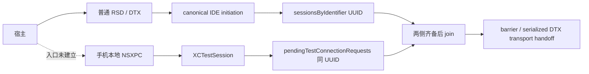

# 通讯协议与 AX P0 findings 汇总

提交分支：`codex/ax-protocol-findings-20261014`，基于当前 main `3842611`（v0.4.0）。
研究来源：`codex/ax-p0-research-20261013` / `e758406`，原基线为 PR #2 的 `6b84247`；下述实测保持原日期、版本和范围。
状态：截至 2026-10-14 的已有 findings 已汇总；无 Runner、无剪贴板的原生带参 AX 输入仍未打通。
最后核对：2026-10-14，Asia/Shanghai。本次整理不新增输入实测，不改产品代码或默认输入方式。

## 1. 需求、范围与证据口径

目标是厘清 ipb 当前的通讯链路、DevicesApp AX 与 XCTest 的能力差距，以及
UITextView/TextEditor 的 AX 写入为何没有业务响应。继续探索的目标是直接插入文本并触发真实业务
回调，同时不启动 Runner、不用剪贴板、不安装手机输入服务，也不由测试应用手工调用回调。
本页按结论组织资料；原始消息、完整日志、临时脚本和成功验收材料保留在 Git 外。

主要研究平台为 macOS26.5.1/25F80、Xcode27Beta6/27A5252f、CoreDevice642.15、DDI27A5252f。
13 Pro 是 iPhone14,2，12 mini 是 iPhone13,1；相关实测均为 iOS27.0/24A437。
不同日期、设备和会话状态的结果分别注明；13 Pro 的业务矩阵不能代替 12 mini 的业务验收。
过去启动 XCTest 仅作独立对照；后续无 Runner 路径的研究不启动该参考实现。

| 资料 | 用途 |
| --- | --- |
| [当前 UI 用户契约](ui.md)、[mirror 使用](mirror.md)、[CLI](../bin/ipb) | 区分产品已实现的功能与临时探针 |
| [完整协议与来源](protocol.md)、[Wire Format](protocol.md#wire-format-captured-2026-09-07) | 精确请求、字段、二进制版本、UUID/VM 和推断边界 |
| [当前问题状态](verification.md#open-items--current-state-living-section)、各 dated record | 区分实测效果、根因状态、清理结果与未完成门禁 |
| [deep snapshot 原设计](ax-deep-snapshot.md) | 已合入的深层树、状态补读、hit-test/press 实现 |
| [分发与跨平台计划](standalone-distribution.md) | 无完整 Xcode 的输运 spike 与尚未完成的客户端 |
| Figma、Looktech App/固件需求、App↔眼镜 schema/rpc | 本次不涉及，不改变相关契约 |

证据状态：**实机已验证**仅指注明的设备、页面、控件和操作；**源码确认**指匹配的 shipped
metadata/二进制实现；**产品已实现**指当前代码及其已记录验收；**未验证**包括没有到达实际接收者的阶段。
能力广告、channel-open ACK、void reply、`rc=0` 均不能代替设备效果和业务响应。

## 2. Findings 与当前结论

已经能取得接近 XCTest 的 native 深层树，但完整性和状态语义仍受页面、请求上下文影响。
AX 整字段写入在六类受控控件中均能改文本，业务响应却只通过四类；UITextView/TextEditor 的缺口
已定位到 UIKit 回调路径。原生插入动作存在，APT getter/token 桥也可用，但 AXAudit 丢掉 value。
保留 value 的 testmanagerd 实现已找到，宿主到合法接收者的准入仍未建立。因此保留当前 paste
输入；不把 AX 替换值、补一对 HID 编辑或成功握手当成通用输入替代品。

### A. 当前功能实际走的链路

| 功能 | 当前产品路径 | 能力与边界 |
| --- | --- | --- |
| 触控、滑动、长按、普通按键 | CoreDevice service socket → DDI `dtuhidd` → UniversalHID reports | 物理输入；`key` 使用 KeyboardReport 和新发现的 serviceID，不走 AX setter |
| Home、侧键、App Switcher 等 | CoreDevice/Indigo 按钮路径 | 已捕获的按钮事件；与触控手势模拟、AX press 是不同链路 |
| `ipb text`、mirror 提交的文本 | `devicectl` pasteboard 写入 → HID Command+V | 当前正常文本路径；会替换剪贴板，提交后仍需核对焦点和实际文本 |
| `ui`、`--deep`、`--full-state` | 配对 USB userspace RSD → raw DevicesApp AX DTX → APT/AXRuntime | 普通图、native 深层树及显式状态补读（v0.4.0 deep schema2 将 native 树与后续 supplementalAX 状态分开）；产品读取不启动 XCTest |
| `ui hit-test` / `ui press` | 同一 raw AX 路径；fresh hit、type7/action5 | 已集成的受保护单次动作；旧 dump ID 不能当 action token |
| 截图、应用/进程/文件等管理 | CLI 调用相应 `devicectl` 操作 | 可用 CLI 不等于独立 raw 协议已映射；文件操作限定 app container |
| `stream` / `mirror` 图像 | CoreDevice media → `dtremotedisplayd` / AVConference → 解码与呈现 | 媒体链路与 AX 树、HID 输入分开；不能用帧尺寸直接代替 native 触控几何 |
| AX 整字段写入、选择区、action11 滚动、原生插入探针 | 临时 raw AX / AXAudit / testmanagerd 探针 | 研究能力，未成为通用产品输入；后文逐项标明效果与准入 |
| XCTest/WDA | 过去的独立比较基线 | 不在当前 `ui` 产品调用链中；参考 Runner 的成功不证明无 Runner 实现成功 |

来源：[CLI](../bin/ipb)、[HID wire](protocol.md#wire-format-captured-2026-09-07)、
[media plan](video-stream.md)、[DevicesApp AX](protocol.md#devicesapp-ax-over-raw-dtx-2026-10-11)。

| ID | 发现 | 状态、含义与来源 |
| --- | --- | --- |
| F01 | CoreDevice 功能、RSD 服务、DTX role 与本地 Mach/NSXPC 是不同的路由层 | **源码+实机**。不能用 capability 名或 MachServices 注册名推导宿主可调用入口。[宿主桥接](protocol.md#host-to-phone-local-nsxpc-bridge-boundary-2026-10-14) |
| F02 | 当前普通按键走 UniversalHID；KeyboardReport 是312bit/39B，表示 held usages 集合 | **产品+历史 capture**。`hid.keyboard` 能力名不能证明独立 Unicode 文本 socket；按键/组合键、提交 Unicode 字符串和手机 IME 候选处理是不同验收。[键盘 framing](protocol.md#device-hub-digitizer-keyboard-and-target-ids-runtime-capture-2026-09-21)、[mirror 键盘实测](verification.md#2026-10-12--mirror-keyboard-mac-input-methods-and-text-clipboard) |

### B. 树、快照与 XCTest 差距

| ID | 发现 | 状态、含义与来源 |
| --- | --- | --- |
| F03 | 自动 frontmost/root 选择曾返回无关 PDUIApp；系统 point hit 后取该 PID 的 application root 在记录页面可用 | **13Pro 实机**。前台选择与图完整性分开；启动 splash 的 hit 可返回 nil/error8，不能默默选其他应用。[root 选择](protocol.md#root-selection-geometry-and-proof-limits) |
| F04 | APT52/native95006 的 nil 已定位：缺少、空或非数字 `attributes` 数组 | **源码+13Pro 实机+已合入**。缺省/空/`["2003"]` 返回 nil/error0，数字`[2003]`返回树；早期设备 nil 与旧 host nesting 解码失败是两件事。[nil 根因](protocol.md#required-numeric-options-resolve-nil)、[deep 设计](ax-deep-snapshot.md) |
| F05 | 同页三组 AX/XCTest/AX 比较匹配 Calculator45、History99、Settings171 的 ordered paths | **13Pro active-reference 实机控制**。可用 frames、full-state enabled 匹配；CGRectNull 保持 unavailable，visibility/focus 不等同 XCTest。同页 Settings 批量读取约1.83s、WDA约2.00s，full-state约3.48s，仅是记录请求成本；不是任意 App 完整树或普遍性能证明。[同页比较](protocol.md#same-page-xctest-comparison-and-native-element-press-2026-10-13) |
| F06 | 171/138 差异未根因化；额外33 records 是11组 UIView、_UISystemBackgroundView、_UICollectionViewListCellContentView wrappers | **档案重分析+13Pro 控制**。干净 client0/2/3/0 都为138/depth20；client2/3 只改变52个 native2025 visibility，未补回 wrappers。匹配源码只缩小到container/supplementary及有identifier的UIView子视图枚举路径，尚未定位包含flag。APT override 与 XCTest requesting-client 不能等同。[context 控制](protocol.md#request-context-affects-visibility-but-has-not-recovered-the-missing-wrappers) |
| F07 | native 深层图要保留真实 child edges、重复 handle 的每个 path occurrence；Web root 有跨进程边界 | **产品+实机**。不能全局按 handle 去重；ids 只属于本次 snapshot。Web root42 records/38 handles 停在 AXRemoteElement，定点52读出12-record WebContent 子树；通用递归扩展未实现。[解码契约](protocol.md#product-decoding-and-observation-contract)、[Web 控制](protocol.md#ax-hid-and-xctest-business-response-comparison-2026-10-14) |
| F08 | Bilibili title Label3 超时来自设备 secure archive 丢回包，Description33 可避开该 rich-output 路径 | **源码+13Pro 实机+已修复**。NSCocoa4866/4864、`__NSCFType` 不支持 NSSecureCoding；不是延长超时能解决。确切 CF-backed attribute key 仍未知。v0.3.0 动态 login/keyboard 的跨读取冲突已由 v0.4.0 native-only deep/separate state 收敛；普通 root、native lifetime 和通用覆盖仍开放。[Label 根因](verification.md#2026-10-12--bilibili-label-root-cause-device-secure-archive-drops-the-reply)、[当前读法](protocol.md#description-first-reads-after-a-bilibili-label-timeout-2026-10-12) |

### C. 会话、push、句柄与已验证动作

| ID | 发现 | 状态、含义与来源 |
| --- | --- | --- |
| F09 | 删除对象 error8；保留的后台页可读 label 但 frame0/visiblefalse；停止进程 error17 | **13Pro fixture 实机**。一次跨连接成功读取不构成可复用 action identity；操作前仍需 fresh PID/handle/状态/hit。[lifetime](protocol.md#push-scope-and-translation-handle-lifetime-are-independently-observable) |
| F10 | 导航后 push 出现新的 InitialDump/AdditionalData，未观察到 TreeDestroyed 或 atomic generation 契约 | **13Pro 实机**。push 是 AX surface 更新，不保证完整 deep tree；产品继续标`atomic=false`，observer generation/backpressure 待研究。[同一来源](protocol.md#push-scope-and-translation-handle-lifetime-are-independently-observable) |
| F11 | fresh guarded press 已集成；action11 可直接滚动已知 offscreen Row20 | **产品+13Pro 实机**。Row20 y1485.33→646、scrollY0→839.33；已可见目标 false/error0 且不动，Row00 能滚回0。不能套用 press 的 false 语义；recycled/未知 row 未测。[press](protocol.md#exact-hit-testing-and-one-shot-action-wire)、[scroll](protocol.md#authorized-continuation-textview-marked-selection-and-direct-offscreen-scroll) |

### D. 文本语义、业务回调与补偿方案

| ID | 发现 | 状态、含义与来源 |
| --- | --- | --- |
| F12 | AXP8/attribute53 是整字段替换；选择区用 UTF-16，ack 不代表 range 真生效 | **13Pro 实机**。替换忽略原 selection；field 将换行转空格，TextView 保留多行；surrogate 内部 range 可被接受，越界 range 可 error0 但不变。整字段替换清除程序化 marked range，selection 内/外设置保留它；不等于真实中文 IME 实测。[文本边界](protocol.md#whole-text-value-and-native-range-are-real-edits-with-lossyignored-boundaries)、[marked 控制](protocol.md#authorized-continuation-textview-marked-selection-and-direct-offscreen-scroll) |
| F13 | 六控件均有 exact ASCII 文本，但 AX 业务通过4/6，HID/XCTest6/6；Unicode 复现 multiline 缺口 | **13Pro 受控业务矩阵**。UITextView/TextEditor 显示值已改，model空、无 filter hits、submit disabled，blur 后仍然如此；无当前 Runner、有参考及参考移除后控制一致。仅限这些 subscribers。[完整矩阵](protocol.md#ax-hid-and-xctest-business-response-comparison-2026-10-14) |
| F14 | multiline 回调遗漏来自 UIKit 的路径差异 | **匹配24A437源码+delegate 实机 telemetry**。field setter：setText→fieldEditorDidChange→editingChanged/notification；view setter：setText→keyboardInputChanged:nil，仅转发给实现该 private selector 的 delegate。两个实际 delegate 只支持 public didChange，AX 不进入业务路径；public setAccessibilityValue override 也没被调用。[回调根因](protocol.md#multiline-ax-callback-cause-and-edit-alternatives-2026-10-14) |
| F15 | 相同最终文本不代表相同事件事务；没有已证实的通用 callback-only 操作 | **13Pro 实机**。AX field1事件，对照 typing4；Web AX empty-delete/whole-insert 的 trusted input 与 typing/paste 序列不同，SwiftUI onChange 可省略中间 Binding。AX→全选→同文本 paste 对 multiline 产生1次业务编辑；space→Backspace 产生2次和额外空格中间值。当前 paste 单独在6类控件通过，不把补偿编辑自动接到 AX 后。[业务事件](protocol.md#ax-hid-and-xctest-business-response-comparison-2026-10-14)、[补偿](protocol.md#multiline-ax-callback-cause-and-edit-alternatives-2026-10-14) |

六类控件的最终业务判定包括独立 model、filter results、button enabled 和实际 local submit；不是只读 AX value。

| 控件 | AX 整字段 | HID ASCII typing | XCTest typing | 当前 paste 控制 |
| --- | --- | --- | --- | --- |
| UITextField | 通过 | 通过 | 通过 | 通过 |
| UITextView | 文本改，业务未更新 | 通过 | 通过 | 通过 |
| SwiftUI TextField | 通过 | 通过 | 通过 | 通过 |
| SwiftUI TextEditor | backing text改，Binding未更新 | 通过 | 通过 | 通过 |
| HTML input | 通过 | 通过 | 通过 | 通过 |
| HTML textarea | 通过 | 通过 | 通过 | 通过 |

来源同 F13–F15。历史参考使用本地WDA16.14.2来源，临时副本移除了改全局键盘偏好的setup调用，保留typing实现；没有Git metadata证明其为干净upstream revision，不据此作通用性能比较。ASCII匹配控制使用当时的 English(US)，原简体拼音选择已恢复。
`业务中文🙂` 的 exact string 控制不能代替真实 IME composition/candidate/backspace 验收。

### E. 0x807/0x808：原生接收者与 value 丢失位置

| ID | 发现 | 状态、含义与来源 |
| --- | --- | --- |
| F16 | 原生0x807/0x808的 text insertion 实现存在 | **匹配 UIAccessibility 源码**。807 为 attributed text/alternatives，808 为 NSString 或含 text/source/createsUndoableAction 的字典；replacement block 属于其他分支。807 archive、dictionary/undo/selection/IME 的远程效果尚未验收。[native receiver](protocol.md#native-receiver-actual-actionvalue-meanings) |
| F17 | APT59 可转 native0x887 插入/删除 getter，APT60 输出20B native token | **源码+13Pro 实机**。普通 getter 参数为`{parameter:{attribute:2183}}`，可选内层 parameter 应省略；null 会走参数化分支/error3。物理机也返回`AXElementTokenSimulator`，不能据名字判断 simulator；token 跨页/长期 action 生命周期未知。[getter/token](protocol.md#devicesapp-getter-and-native-token-bridge) |
| F18 | AXAudit action入口丢 value，manager又用无参数 action API并丢 native status；setValue/parameterized getter 是 stub | **源码+13Pro 实机**。Reset action改变generation证明该fixture action准入；四个有效808 ASCII/中文请求留下空文本/空模型/0回调，HID对照更新业务。不是参数字典换个形状即可恢复。APT17个映射动作/default custom action也未提供native passthrough；已记录的 Inspector property/action 读取有task-port过滤路径。[丢值位置](protocol.md#axaudit-admitted-no-value-action-discarded-text-value)、[Inspector stub](protocol.md#axaudit-physical-daemon-handlers-permission-logs-and-element-preview-2026-10-09) |

### F. testmanagerd：保参实现、UUID join 与宿主桥接

| ID | 发现 | 状态、含义与来源 |
| --- | --- | --- |
| F19 | 独立 RemoteAutomation handler 可保留 action/element/value 到 AXUIElementPerformActionWithValue | **匹配DDI源码**。`.remote.automation` listener 注册有 internal-security-policy 条件，接入还有 Automation Mode 操作；13Pro三种 bounded bootstrap 无对应reply，未到beginSession/输入。广告不等于准入，policy=false 未直接观测，超时根因未定。[保参与 gate](protocol.md#ddi-testmanagerd-value-preservation-exists-admission-remains-unresolved) |
| F20 | 普通`.remote`支持无Runner IDE/control initiation，但不等于 AX session | **13Pro/12mini实机+源码**。canonical legacy pair返回13capabilities，登记UUID/control；每次4s内无reverse Driver。Apple会把modern protocol对象映射成legacy wire alias，直接发modern名字的失败不是版本不支持证明。普通连接的已知AX proxy screen query明确handler unavailable/invalid-channel1。[ordinary sessions](protocol.md#ordinary-testmanagerd-session-creation-and-transport-handoff-2026-10-14) |
| F21 | UUID join 还缺手机本地 XCTestSession 的 pending reply；转交的是DTX transport | **DDI+iPhoneOS-target XCTestCore源码**。IDE initiation→sessionsByIdentifier[UUID]；本地NSXPC请求serialized transport→pendingTestConnectionRequests[同UUID]，两项齐才barrier/cancel-with-serialized-transport，不能将其当成AXManager已返回宿主。本地XCTestSession的保参AX方法还检查UITestControl/automationServices，未见该readiness函数硬性检查Runner PID。host远程provider为RSD→DTX，本机provider的NSXPC socket适配不能当成手机桥。`.runner`、`.control`、`.remote.runner`按名称创建socket在12mini均1001/noFD；HID和普通`.remote`正对照有FD。XPC Peer/CreateServiceConnection仍是RSD/FD路线。RemoteRunner broker独立于UUID-map，其readiness为Automation Mode开启或internal-client entitlement，不能写成无条件entitlement门槛。[UUID origin](protocol.md#uuid-join-nsxpc-origin-and-the-object-being-transferred)、[12mini桥接](protocol.md#host-to-phone-local-nsxpc-bridge-boundary-2026-10-14) |
| F22 | 普通socket在DTX handshake/proxy建立前关闭，可留下continuation警告和pending harness | **12mini实机**。一次FD-only早关闭后，后续合法session仍工作但pending0→1；Apple缺失的取消/resume分支及具体pending对象identity未完全定位。核对无其他活动session后仅SIGTERM本轮新启动的daemon，最终PID消失。13Pro早期modern-literal后的9→10仍只属该旧daemon，因果/残留清理未完全证明。[生命周期记录](verification.md#2026-10-14--host-to-local-nsxpc-bridge-admission-on-iphone-12-mini) |

当前缺口可以用下面的两侧 join 表达；虚线表示尚未恢复的宿主入口，不表示它不存在。

**12 mini 的 UITextView/TextEditor 原生带参插入、业务回调和submit仍未到达测试阶段。**
这与13Pro经丢值AXAudit入口得到的0回调结果分开；不能把未到达记成一次失败/no-op实测。
也没有证据证明所有无Runner方案不可能，或 inspected readiness 硬性要求一个Runner PID。

### G. 已看过的旁路与尚未覆盖的能力

Inspector/AXAudit 的 task-port、rich property/issue 与 DevicesApp native getter 是不同路径；
[Mirroring/MCK](protocol.md#normal-mirroring-transport-entry-and-mck-discovery-2026-10-11) 又有自己的
pairing、consumer安装和host权限条件。它们的符号、RPC签名或服务广告不能代替手机 tree/input 效果。
当前生产读取使用已经实测的 DevicesApp raw DTX，不能退回旧的“手机上完全拿不到树”结论。

与 XCTest 仍有的差距：任意 App/overlay 的完整树、wrapper包含条件、XCUIElementType映射、
visibility/focus语义、atomic snapshot/observer generations、跨进程Web扩展、动态recycled元素，
以及没有剪贴板的通用Unicode输入、真实手机IME、secure/custom controls、selection/undo一致性。
独立[跨平台输运](standalone-distribution.md)只有已记录spike，不是完整CLI/MCP/截图方案。
完整原生 macOS27/Xcode27/iOS27 HID/media/设备选择/interactive gate仍按verification记录为开放；
本地macOS26或SSH转发AX结果不能关掉该门禁。

## 3. 当前设计、验收边界与继续研究顺序

当前设计继续使用 v0.4.0 CLI/AX backend：普通AXChildren默认，deep/full-state显式选择。
Deep schema2 以一次 native snapshot 为树/几何来源，后续状态保留在 supplementalAX，不作跨读取合并；
Description-first、真实child/path、缺失字段、fresh hit/press guard、有限请求预算和明确失败退出保持。
当前契约见[原生树与独立状态](protocol.md#native-only-observation-and-separate-state-2026-10-14)。
文本保留当前paste，不自动串接“AX替换→space→Backspace”，不对已送输入重试。
本次只整理host工具资料；Looktech Android/iOS、BT/ISP/Wi-Fi、schema/rpc、lt-vad均不受影响，
因为不改变App↔眼镜或音频契约。

| 优先级 | Agent可继续研究的项目 | 根因状态 / 下一判别式 |
| --- | --- | --- |
| 1 | 合法、保留value的宿主接收入口 | `.remote.automation` 的正确Apple客户端序列、listener/admission gate或真正host→local NSXPC relay；先证实实际recipient，再测807/808及业务 |
| 2 | native插入事务 | 仅在准入后测ASCII/中文、selection、807 attributed payload、dictionary source/undo；独立raw text/model/events/submit验收 |
| 3 | 树的context与完整性 | wrapper inclusion flag仍未知；区分APT override、XCTest requesting-client和authorization，补跨进程Web/overlay样本 |
| 4 | 动态元素与observer | recycled handles、root/geometry冲突、generation/atomicity/backpressure；不能以一次稳定截图或重复dump当原子性证明 |
| 5 | 跨平台/原生支持门禁 | 与AX研究分别验收；已有build/CI、转发USB和AX-only smoke不能代替完整native设备门禁 |

仅用户可完成的前置条件是具体系统授权/密码，以及未来需要时提供从未开启automation的设备用于
独立授权对照。现有两台手机的“当前无Runner”不构成“从未授权”；此前授权也不能跨设备推定。
不在聊天收集密码，不改无关账号/全局设置，不占用或终止其他任务的Runner/预存daemon。

拒绝的替代方案：

- 持续变换AXAudit payload或扫描未知ID：明确丢值/stub不能靠序列化猜测修复。
- 把AX值、channel ACK/capabilities或symbol存在当准入/业务成功：各层须独立验证。
- 默认加入补偿编辑、静默浅层fallback、全局handle去重或重放输入：会改变业务事务、隐藏覆盖缺口或删掉真实路径。

## 4. 交付状态与证据索引

本次交付只有资料整理；下表不为尚未完成的输入目标安排发布。

| 需求模块 | 端/仓库 | 负责人 | 预计人日 | 开发分支 | 跟车版本 | 提测时间 | 状态/核对 | 依赖 |
| --- | --- | --- | --- | --- | --- | --- | --- | --- |
| findings 汇总与导航 | macOS host / ipb docs | 待确认 | 待确认 | codex/ax-protocol-findings-20261014 | 待确认 | 待确认 | 已整理；2026-10-14 | 既有源码、dated records及本地handoff |

已有研究/实现的状态：

| 模块 | 端/仓库 | 分支 | 状态 / 最后核对 |
| --- | --- | --- | --- |
| deep树与guarded press | ipb CLI/AX backend | PR #2 的初始实现，PR #5 的 native-only/separate-state 契约；本页只引用结果 | v0.4.0 产品已实现；记录页面/控件验收，通用覆盖仍开放 |
| context/push/lifetime/text/scroll | 临时13Pro fixture | 原研究分支 codex/ax-p0-research-20261013 | 记录范围完成；未解释项见F06–F12 |
| 六控件业务比较/回调根因 | 临时13Pro fixture +过去的独立XCTest参考 | 原研究分支 codex/ax-p0-research-20261013 | 已实测；源码与实际delegates支持因果链，不能扩展为任意App通过率 |
| native getter/token/丢值转发 | shipped frameworks/DDI +13Pro | 原研究分支 codex/ax-p0-research-20261013 | 已定位并实测丢值入口；原生保参输入效果未验证 |
| ordinary/NSXPC/宿主路由 | shipped host/DDI +13Pro/12mini | 原研究分支 codex/ax-p0-research-20261013 | 路由与UUID缺项已定位；保参recipient未准入；早关闭残留已按归属清理 |

负责人、人日、跟车版本、提测时间：尚未排期，待确认；资料整理不暗示产品发布或输入目标已完成。

| 记录 | 主要findings |
| --- | --- |
| [10-13 same-page比较、状态与press](verification.md#2026-10-13--13-pro-same-page-xctest-comparison-structural-state-and-element-press) | F04–F07、F11；合入实现细节另见[deep计划](ax-deep-snapshot.md) |
| [10-14 context/lifetime/text](verification.md#2026-10-14--ax-p0-context-lifetime-and-text-boundaries-on-13-pro) | F06、F09、F10、F12 |
| [10-14 TextView/marked/scroll](verification.md#2026-10-14--authorized-ax-p0-textview-marked-selection-and-scroll-controls) | F11、F12 |
| [10-14 六控件业务矩阵](verification.md#2026-10-14--ax-hid-xctest-business-response-on-iphone-13-pro) | F13、F15 |
| [10-14 回调根因/补偿](verification.md#2026-10-14--multiline-ax-callback-root-cause-and-compensation-on-13-pro) | F14、F15 |
| [10-14 native插入转发/准入](verification.md#2026-10-14--native-ax-insertion-forwarding-and-admission-on-13-pro) | F16–F19 |
| [10-14 ordinary会话/NSXPC](verification.md#2026-10-14--ordinary-testmanagerd-session-and-nsxpc-boundary-on-13-pro) | F20、F21，以及旧13Pro pending限制 |
| [10-14 12mini宿主桥接](verification.md#2026-10-14--host-to-local-nsxpc-bridge-admission-on-iphone-12-mini) | F21、F22，业务阶段未到达和清理结果 |

最后完整12mini实测结束时：PocketAgent仍为前台，未启动Runner、未安装新fixture、未用剪贴板或发送
AX插入；本轮启动的testmanagerd已正常终止并确认消失，五个AX订阅stop均ACK，owned连接/tunnel/cache关闭。
13Pro此前各轮owned fixture/reference已按各自记录移除并恢复原页面；这些是相应dated record的终态。
本次整理只做资料核对与设备身份只读确认，未再执行输入/业务测试。

匹配 binary 完整路径、版本、UUID/VM 和问题复现见 protocol 与上述 dated records；
原始日志、临时探针和成功验收材料保留在 Git 外。
